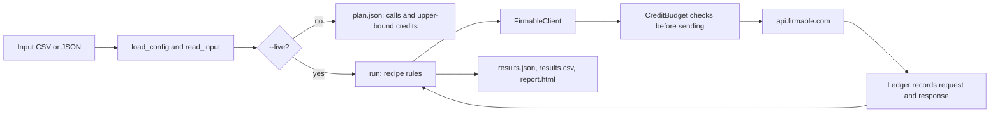

# Architecture

## Layout

```text
gtm-starter-kit/
  shared/python/        firmable-gtm-client: client, budget, ledger, pricing, io, report, recipe, cli, testing
  shared/typescript/    the same modules in TypeScript, linked through npm workspaces
  recipes/<name>/
    README.md, config.example.json, examples/input.csv, curl/requests.sh
    python/             package gtm-<name>, module <name_with_underscores>
    typescript/         package gtm-<name>
  tests/fixtures/<name>/  synthetic scenarios shared by both languages
  tests/parity/         compares Python and TypeScript output
  tests/smoke/          runs every documented plan-mode command
```

## Structural choices

- **One lockfile.** TypeScript uses npm workspaces with a single `package-lock.json` at the root, so the shared client resolves the same way in every recipe from a clean clone. The prompt-level structure placed a lockfile in `shared/typescript`; a root lockfile is what npm workspaces require.
- **Editable Python installs.** Each recipe is its own Python package that depends on `firmable-gtm-client` by name. `requirements-dev.txt` installs them together. Nothing relies on the working directory or `PYTHONPATH`.
- **No runtime dependencies.** Python uses the standard library. TypeScript uses Node built-ins and needs only `typescript` and `@types/node` to build.

## How a run flows



## The recipe contract

Each recipe module exposes `RECIPE` with:

| Part | Job |
| - | - |
| `load_config` / `loadConfig` | Validate the configuration strictly; raise `ConfigError`. |
| `read_input` / `readInput` | Read and validate rows; raise `InputError`. |
| `plan` | List the calls a live run could make, with upper-bound counts and published costs. |
| `run` | The workflow. Returns rows, a summary and coverage notes. |
| `csv_columns`, `csv_rows` | The flat CSV export. |
| `render` | The recipe's own report sections. |

`RunContext.run_rows` runs the workflow row by row, records row errors, and stops on errors that make further calls pointless: a bad key, no credits, the credit limit, or a blocked redirect. Later rows are returned as `not_processed`.

## The client

- Fixed base URL, bearer key from the environment, explicit timeout.
- No automatic retries.
- Redirects refused.
- A per-run cache answers identical requests without sending them again, so duplicate input rows do not cost twice.
- Requests to the same endpoint are spaced to stay under the documented rate limit.
- Responses are checked for the fields a recipe depends on. A response that would produce a wrong report raises `InvalidResponseError`.
- Every request, including refused, failed and cached ones, goes to the ledger without the key.
